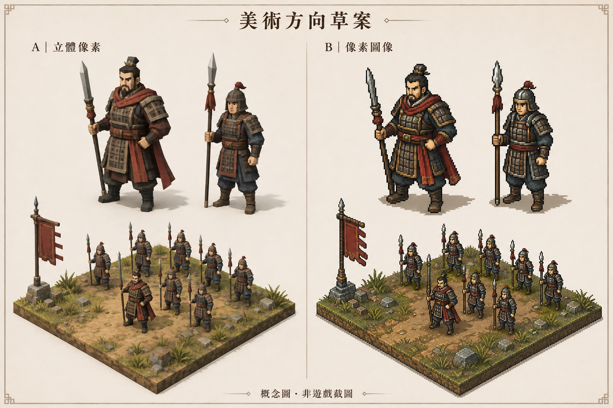

# 美術方向草案 v01

日期：2026-09-06
狀態：概念比較，風格未定案；不是 Godot 截圖、Blender 模型或效能驗收。
來源：Codex 內建 image_gen，以本專案已確認方向生成；未使用參考圖片或第三方遊戲素材。



- A：低面數 3D 與像素材質的視覺參考。
- B：像素圖像／預渲染 2.5D 的視覺參考。
- 兩側嘗試對照相同人物與場景；AI 概念圖仍有細節差異，不是由同一 Blender 模型渲染的公平效能比較。
- 這張圖只提供外觀方向，未包含可用的角色網格、材質貼圖、骨架或動畫。下一步先從一名士兵驗證實際製作與 Godot 匯入成本。
- 關聯：[美術與工具決議](../../docs/decisions/TD-002_GODOT_BLENDER_ART_PIPELINE.md)。

## 最終生成提示詞

使用內建 image_gen 模式，未使用 CLI／API 備援。

```text
Use case: stylized-concept
Asset type: ONE landscape art-direction comparison board, an original concept proposal for Living World RTS, an ancient-Chinese-inspired RTS/RPG game developed with Godot and Blender.
Primary request: Show two distinct, attractive, economical art directions side by side using THE SAME character designs, same small terrain scene, and same viewing angle. The user wants low resource use, high performance, good production value, and is interested in pixel games. This is a visual reference for discussion, not an actual rendered game or technical performance claim.
Composition: A carefully arranged single wide board, two equal columns, with generous neutral space and a clear simple divider. Each column shows in the upper area an enlarged full-body comparison of one unnamed commander and one ordinary spearman, and in the lower area an isometric small battlefield vignette with these designs among a modest formation of around twelve soldiers on the same patch of ground. Faces, silhouettes, equipment, ground layout and lighting should match across columns. Characters' feet and weapons are fully in frame. The commander should be recognizable by stance, armor silhouette and a modest cloth accent, while still belonging to the same human world as the soldiers.
Column A: visibly faceted, economical real-time low-poly 3D miniatures with deliberately simple forms, small pixel-art textures, limited material complexity, legible flat planes, restrained lighting and crisp silhouettes. Honest attainable indie-game visual target, not an expensive realistic promotional painting.
Column B: beautifully readable isometric pixel-art sprites and tiles, showing how the same Blender-origin designs could look as pre-rendered sprite imagery. Use coherent visible square-pixel clusters, selective outlines, stepped contours and a consistent pixel grid. Preserve the detailed shape language in a deliberately simplified form. This side must look distinctly sprite-based rather than a second smooth 3D render.
Subject and setting: Original unnamed human commander and ordinary infantry inspired by the project's ancient Chinese martial setting. Simple lamellar armor, cloth, a spear, practical equipment; natural ground, grass clumps, a few rocks and a modest plain military flag. Shared restrained palette and material colors across both sides. Distinction through character silhouette, equipment and body language.
Art direction: polished but achievable small-studio game art, clear shapes and group readability at a tactical camera distance, enough individual personality to notice an interesting person among ordinary soldiers. Use restrained soft daylight, no cinematic depth-of-field obscuring units.
Text, exact Traditional Chinese, minimal and legible: overall title "美術方向草案"; left column "A｜立體像素"; right column "B｜像素圖像"; small footer "概念圖・非遊戲截圖". No other words, stat panels, logos or watermarks.
Avoid: existing game characters or screenshots, recognizable copied franchises, rarity stars, gacha cards, health bars, glowing hero auras, oversized fantasy pauldrons, excessive tiny detail, photographic skin, dramatic particle effects, gore, user interfaces, developer code, or claims about polygon count or frame rate.
```
