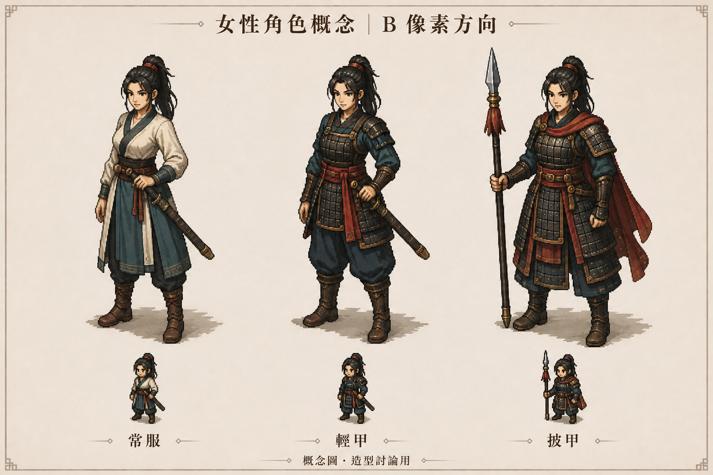

# 女性角色概念｜B 像素方向 v01

日期：2026-09-06。狀態：概念圖，供外觀討論，尚未經使用者確認。



使用者認為前一份人體像素基底不好看，要求先看女性的概念圖。本圖採 B 像素方向，以同一名成年女性呈現常服、輕甲、披甲三種穿戴造型，先討論人物氣質、比例、配色與衣甲輪廓。

這是 Codex 內建 image_gen 生成的概念圖，並非 Blender 模型、實際動畫或 Godot 畫面。圖中縮小的人物也屬概念示意，未驗證固定像素網格、動畫一致性、分件換裝或引擎效能。不得將本圖的完成度宣稱為已實作結果。

風格參考：本專案 [美術方向草案 v01](art-direction-v01.md) 的 B 半側。
原始輸出保留於 `C:/Users/f7212/.codex/generated_images/01a0712a-0d37-7dc2-bd31-b227142e5f76/exec-2617259f-7dd6-4c36-8e44-8b673e5635c8.png`，本目錄保存相同圖檔。

## 生成提示詞

工具：內建 image_gen；輸入參考圖：`blender-assets/concepts/art-direction-v01.png`；未使用 CLI／API 備援。

```text
Use case: stylized-concept.
Create a polished female-character version of the supplied art-direction board, taking ONLY the right-hand panel labeled B｜像素圖像 as the visual reference. Replace the male designs and battlefield with ONE original adult Chinese woman character shown in three clothing/equipment variants. This is a beautiful character concept sheet for an ancient-Chinese-inspired living-world RTS/RPG, not a nude body modelling test or a technical rig sheet.
The user rejected crude, ugly mannequin-like modelling and wants to see the appeal of a genuinely well-designed female character. Prioritize exceptional character appeal, confident personality, attractive mature facial design, elegant yet strong silhouette, natural anatomy, convincing hands, expressive eyes, and beautiful carefully composed pixel clusters.
Character: the SAME clearly adult woman about 28–32 throughout, with a distinctive refined East Asian face, dark almond-shaped eyes, composed and intelligent expression, athletic graceful build, natural roughly seven-head proportions, dark hair tied high with a simple red cord, a few controlled strands framing her face. Recognizably the same woman in every outfit, no chibi, no childlike face, no generic male figure with a ponytail.
Style: the richly designed, dark-edged isometric pixel-art style of reference B. Visibly deliberate square pixels, crisp stepped contours, controlled warm highlights and cool shadow clusters, selective outlines, restrained earthy palette, readable textile folds and lamellar armor patterns. It should resemble excellent finished pixel character design enlarged with nearest-neighbor sampling, NOT a smooth 3D render, NOT faceted low-poly geometry, NOT a flat posterized or pixel-filtered photo, NOT smooth anime painting.
Composition: one clean landscape concept sheet with three generously spaced equally prominent full-body versions of this same female character, all facing a consistent front three-quarter direction at a modest elevated tactical view. At least two thirds of the page height should be given to the main full-body figures so the faces and outfit craft are readable. Small grounded shadows, plain warm parchment background, restrained simple border, no scenery or extra people. Below each main figure include one very small matching tactical-scale sprite of that outfit to show its silhouette at game viewing distance.
Left variant 常服: refined practical wrapped ivory linen blouse with dark teal trim, fitted-but-natural sleeves, deep teal split overskirt over practical trousers, brown leather belt and boots, a sheathed straight sword at her hip. Elegant everyday martial-world clothing, not modern fashion.
Centre variant 輕甲: deep desaturated teal cloth, beautifully proportioned dark lacquered lamellar chest armor, modest bronze fastenings, red waist sash, leather forearm guards, practical trousers and boots, hand lightly resting on a sheathed straight sword. Compact balanced silhouette with visibly female anatomy under functional clothing, not exaggerated.
Right variant 披甲: the same woman wearing complete dark iron-and-leather lamellar torso protection with small functional shoulder defenses and layered skirt panels, dark teal sleeves, muted crimson short shoulder drape and sash, solid leather boots. Holding a tasteful ancient spear, shaft visibly meeting her hand. Dignified charismatic commander presence; no oversized fantasy pauldrons.
Keep facial features and outfit construction readable; a restrained combination of ivory, ink-black iron, antique bronze, deep teal and muted vermilion. No large smooth airbrushed skin areas; tonal transitions should be intentional pixel clusters. All bodies, shoes, and weapons fully inside the frame.
Traditional Chinese text only, exact and minimal: title "女性角色概念｜B 像素方向"; captions "常服", "輕甲", "披甲"; small footer "概念圖・造型討論用". No other writing.
Constraints: entirely original unnamed character, fully clothed, practical equipment, no existing franchise character, no UI panels, no health bars, no rarity stars, no stats, no claims of an implemented model or actual Godot screenshot, no anatomical diagram or skeleton. The three outfits are appearance variations, not game classes.
```
