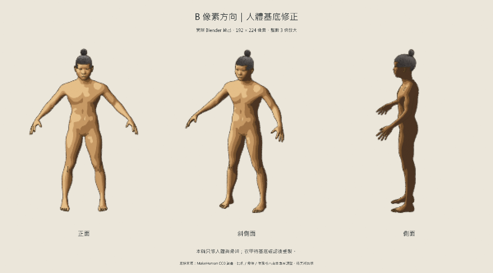

# 人體與 B 像素方向修正 v02

日期：2026-09-06。狀態：**修正版待使用者美術審核**，不宣稱已達到 B 概念圖的完成度。

使用者否決 v01 的人體與骨架造型，並指出成品與 B「像素圖像」差異極大。v01 使用拼接幾何及攝影棚 3D 直出，沒有完成 B 的像素製作流程；其引擎匯入檢查不能替代美術驗收。本輪先回到人體與骨架，衣服、胸甲及武器未重製。



## 本輪修正

- 使用 [MakeHuman CC0 基底](../../sources/makehuman-a8bc2d5/README.md) 取代拼接的軀幹／肢體。人體為一個連續網格，有完整肩、髖、膝、手掌及手指；頭身比例另作調整。
- 從上游骨架與權重資料重新配置為 52 根骨骼，保留手指供後續握持；每個頂點最多四個骨骼影響，權重重新歸一。骨架供 Blender 製作端使用；未把它定為即時 3D 的正式效能預算。
- 真正輸出 **192 × 224 像素**的透明角色圖，固定正面、斜側面、側面鏡頭。皮膚以五階明暗處理，加入細輪廓線；預覽以最近鄰取樣整數 3 倍放大，避免平滑模糊。192 × 224 是測試參數，不是最終解析度決議。
- 普通灰模照保留供檢查人體和關節；美術對照以像素圖為主。此次沒有用圖像生成工具重畫或冒充 3D 輸出。

## 檔案

- [pixel-source.blend](pixel-source.blend)：B 方向的像素製作場景，已保留低解析度、皮膚色階、輪廓與固定鏡頭設定；可重新渲染。
- [body-rig.blend](body-rig.blend)：相同人體／骨架的普通材質檢查場景。第 1–49 幀含手臂與頭部姿勢測試。
- [body-rig.glb](body-rig.glb)：普通材質的骨架模型匯出檔，未包含 Blender 程序像素材質；本輪未另做 Godot 匯入驗收，不能沿用 v01 的檢查結果。
- [斜側面灰模](body-clay-quarter.png)、[姿勢檢查](body-clay-pose.png)、[骨架疊圖](rig-overlay.png)：骨架疊圖的線條取自實際骨骼，為方便閱讀投影到人體正面；不代表模型表面有外露骨骼。疊圖省略細小手指骨。
- [正面像素原圖](pixel-front.png)、[斜側面像素原圖](pixel-quarter.png)、[側面像素原圖](pixel-side.png)。
- [build-report.json](build-report.json)：連通性、骨架、權重、姿勢變化及上游檔案雜湊。

## 驗證與界線

Blender 5.1.2 建模與渲染成功。人體有 13,380 個頂點、26,756 個三角面，連通性檢查為單一網格組件；權重歸一檢查通過，測試姿勢確實改變人體。已目視檢查灰模、姿勢、骨架疊圖及像素三視圖。

這是離線製作像素圖的人體源模型，未完成即時模型減面、換裝動畫圖集、Godot 畫面及大量人物效能驗收。B 概念圖含更完整的角色設計與像素細節；目前只有基底與輸出流程修正，臉部個性、裝備造型及整體風格仍須後續驗證。傷害功能仍未實作。

重建：[build_body_pixel_revision.py](../../../scripts/build_body_pixel_revision.py)。從專案根目錄執行：

```powershell
& 'C:/Program Files/Blender Foundation/Blender 5.1/blender.exe' --background --factory-startup --python-exit-code 1 --python 'scripts/build_body_pixel_revision.py'
```

腳本會更新本目錄的模型、報告與預覽；v01 保留不覆蓋。
