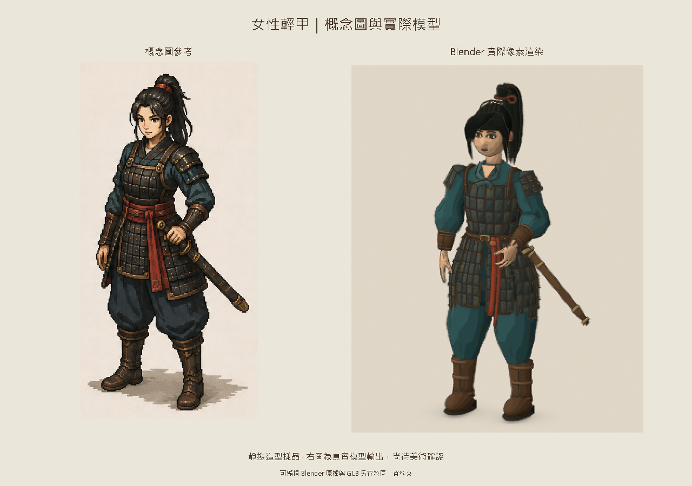

# 女性輕甲靜態樣品 v01

2026-09-06。依使用者認可的[女性概念圖](../../concepts/female-character-b-v01.png)中央輕甲造型建模。狀態：**靜態美術樣品，待使用者確認**；不能以匯入成功代替外觀通過。



## 可查看的產物

- [可編輯 Blender 原檔](female-light-armour.blend)：人體、姿勢骨架、獨立頭部與髮型、衣服、黑甲、紅腰帶和佩劍；集合與零件分開保存。
- [像素材質與相機原檔](female-pixel-source.blend)：五階明暗、環境遮蔽、固定正交相機、270 × 340 像素與輪廓線。
- [靜態 GLB](female-light-armour-static.glb)：合併為六組可各自隱藏的網格，保留普通材質。Blender 的像素材質不會隨 GLB 自動移植到 Godot。
- 真實模型渲染：[斜側面](model-quarter.png)、[正面](model-front.png)、[背面](model-back.png)、[臉部](model-face.png)、[96 × 128 遊戲尺度預覽](game-scale-preview.png)。這些畫面都由實際幾何輸出，沒有使用 AI 重繪替代模型。

## 製作與限制

人體和 52 根姿勢骨架來自固定版本的 [MakeHuman CC0 資產](../../sources/makehuman-a8bc2d5/README.md)，並採成年女性形態。風格化頭部、髮型、衣物、甲片、腰帶與武器由本專案建模腳本產生。完整底模保留在原檔；關閉人體的衣物遮蔽修改器可查看。

本輪處理靜態造型與同角度比對。衣甲、另製的頭部及髮型尚未完成蒙皮；不能直接當作可換裝、可播放全身動畫的成品。手部姿勢、頭髮輪廓與布料細節仍與概念圖有差距。

GLB 約 13.1 萬個三角面，定位為離線美術來源及匯入樣品；尚未達量產 RTS 即時角色的效能要求。像素圖展示離線輸出方向，未因此鎖定整個遊戲為純 2D。Godot 匯入結果與素材 SHA-256 記錄於 [驗證報告](godot-import-report.json)；畫面由 Blender 渲染，未量測 Godot 遊戲效能。

## 重建

依序執行，不要同時覆寫同一組輸出：

```powershell
& 'C:\Program Files\Blender Foundation\Blender 5.1\blender.exe' --background --factory-startup --python-exit-code 1 --python scripts/build_female_concept_sample.py
& 'C:\Program Files\Blender Foundation\Blender 5.1\blender.exe' --background --factory-startup --python-exit-code 1 --python scripts/render_female_pixel_review.py
python scripts/verify_female_static_godot.py --godot '<Godot 執行檔路徑>'
```

`build_female_concept_sample.py -- --quick` 僅供局部視覺迭代；不會更新全組圖像與 GLB，交付前須完整重建。
