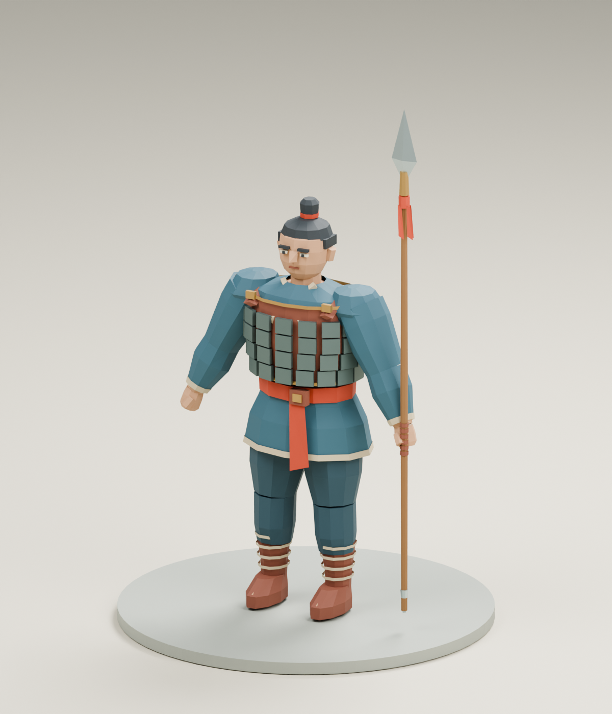
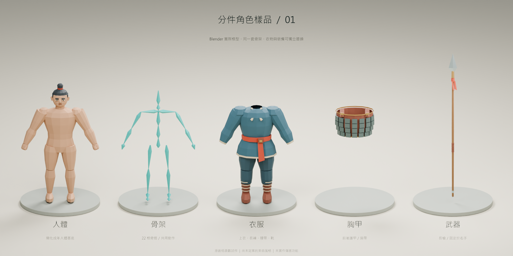

# 分件角色樣品 v01

> **美術驗收不通過（2026-09-06）。** 使用者否決人體與骨架造型，並指出與 B 像素圖像差距過大。下列既有匯入檢查只證明技術流程，不代表美術通過。此版保留作為退回紀錄；目前修正見 [人體與 B 像素方向 v02](../body-pixel-v02/README.md)。

2026-09-06，依使用者指示只製作「人體＋骨架＋衣服＋胸甲＋武器」。這是可編輯的 Blender 低面數 3D 試作；比例、配色和最終美術風格仍供討論。





## 檔案與使用方式

- [character.blend](character.blend)：Blender 5.1.2 源檔。`CHARACTER` 集合內的五個物件可各自選取；在大綱視窗切換衣服、胸甲或武器的顯示，即可查看人體或不同穿戴組合。`PRESENTATION` 集合只供攝影棚展示，不匯出。
- [character.glb](character.glb)：同一角色的 glTF 2.0 匯出檔，含四個網格、一套骨架與 `Rig_Check_3s` 姿勢檢查動作。已由 Godot 4.6.3 實際匯入驗證。
- [pose-check.png](pose-check.png)：第 25 幀的手臂／頭部姿勢檢查。Blender 時間軸第 1–73 幀可播放此測試動作；這不是完成的行走或戰鬥動畫。
- [build-report.json](build-report.json)、[godot-import-report.json](godot-import-report.json)：實際建模與引擎匯入檢查結果。

| 分件 | 目前內容與連結 |
|---|---|
| `01_Body` 人體 | 簡化的成年人體基底、手腳、臉、髮髻；不含內部解剖或精細生殖器造型 |
| `02_Rig` 骨架 | 22 根骨骼；人體、衣服、胸甲共用同一套骨架 |
| `03_Clothes` 衣服 | 上衣、長褲、腰帶與靴子，目前合為一個衣服分件；後續可再拆成獨立換裝槽 |
| `04_ChestArmor` 胸甲 | 前後甲片與肩帶，可整件移除或替換；剛性跟隨胸部骨骼 |
| `05_Weapon_Spear` 武器 | 原創簡化長槍，固定於右手骨骼，跟隨手臂姿勢 |

## 已驗證及界線

- Blender：分件可編輯、三個蒙皮網格權重歸一、共用骨架；手臂變姿勢時人體、衣服及武器確實移動。已查看穿戴、拆件及姿勢渲染，修正本次視角中肩部和衣襬的明顯穿插。
- Godot：真實 `.glb` 匯入通過；四個網格、22 根骨骼、三個蒙皮網格、右手武器掛點及可播放的骨架動作均保留。各網格可獨立隱藏。
- 整體 **5,262 個三角面**，`.glb` 為 **503,888 位元組**；包含被衣服遮住的人體。使用純色材質，沒有貼圖或外部模型下載。Godot 匯入後共有 **19 個材質表面**，尚未合併材質或處理遮蔽人體，不能由面數推論大量人物的效能。
- 展示圖片由 Blender 渲染；尚未驗收 Godot 畫面、同屏部隊效能、所有視角／所有動作穿插、正式動畫或最終鏡頭。幾何為程序建構的試作網格，關節與分段輪廓仍可精修，尚非量產完成品。
- 使用者已指出「肢體受傷造成能力影響」與遊戲架構衝突；此規則暫停採用、待重新討論。樣品沒有傷害、血量、斷肢、失能或戰鬥程式。

## 重建

源程式為 [build_modular_character_sample.py](../../../scripts/build_modular_character_sample.py)。從專案根目錄執行：

```powershell
& 'C:/Program Files/Blender Foundation/Blender 5.1/blender.exe' --background --factory-startup --python 'scripts/build_modular_character_sample.py'
```

重建會更新此樣品目錄的 `.blend`、`.glb`、圖片及建模報告。獨立的 [verify_character_godot.py](../../../scripts/verify_character_godot.py) 接收 `--godot <Godot 執行檔>`；在自建的暫存專案匯入目前 `.glb`，驗證後移除該暫存目錄，留下引擎匯入報告。它不建立正式遊戲客戶端。

人物與裝備由本專案 Blender 程式直接建模。攝影棚標示使用本機微軟正黑體，只出現在展示圖片，不打包字型到遊戲資產；不宣稱特定朝代的考據復原。

建議下一步先依完整穿戴與分件畫面調整人物比例、衣甲輪廓和配色，再用同一角色比較遊戲俯視尺度及像素呈現。
